# SAÉ S1. 05-06 Groupe 7 : Free
**Référent du groupe :** Nolan Fischer  
**Adresse mail du référent :** [nolan.fischer@edu.univ-fcomte.fr](mailto:nolan.fischer@edu.univ-fcomte.fr?subject=SAE_1_05_06)  
**Membres du groupe :** [Doryann Gras](mailto:doryann.gras@edu.univ-fcomte.fr?subject=SAE_1_05_06), [Ilyana Gueraouni](mailto:ilyana.gueraouni@edu.univ-fcomte.fr?subject=SAE_1_05_06), [Mohamed Hedi Hamza](mailto:mohamed_hedi.hamza@edu.univ-fcomte.fr?subject=SAE_1_05_06), [Yanis Iklef](mailto:yanis.iklef@edu.univ-fcomte.fr?subject=SAE_1_05_06)  
## Présentation 

Ce dépôt correspond à un site web créé en HTML/CSS/JS dans le cadre de la SAÉ 05-06 à l'IUT de Belfort-Montbéliard. Ce site présente des informations concernant l'entreprise Free et sert de vitrine pour présenter l'entreprise, ses activités, son organisation et son historique. Free est un acteur du secteur des télécommunications et du numérique. Les différentes pages traitent de l'histoire de la marque, ses produits et envers qui ils sont destinés mais mais aussi sous un angle économique (chiffre d'affaires, parts de marché...).
Pour la conception du site, nous nous sommes grandement inspirés du site officiel de Free (disponible [ici](https://www.free.fr/)) et du site d'un de ses principaux concurrents : [Orange](https://www.orange.fr/portail)

**Lien vers le site Free :** https://saegroupe7.github.io/Free/
## Développement Site Web et Validation des pages :

### Page d'accueil :

**Auteur :** Doryann Gras  
**Utilité :** Accueil, page servant à accéder aux autres  

**Lien vers le résultat de conformité de la page index :** [Cliquer ici](https://validator.w3.org/nu/?showsource=yes&showoutline=yes&showimagereport=yes&doc=https%3A%2F%2Fsaegroupe7.github.io%2)

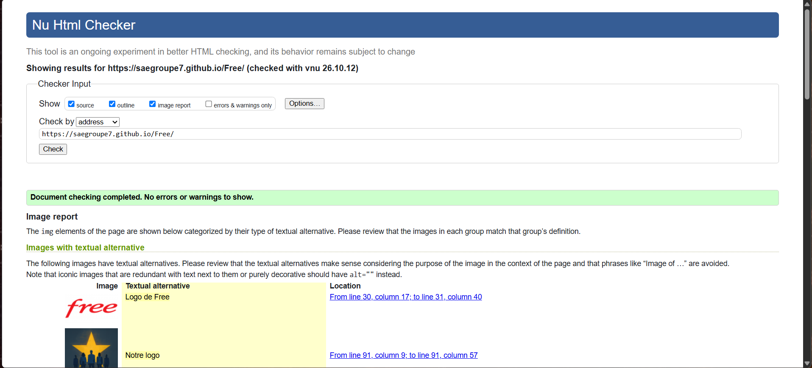

**Lien vers la validation d'éco-conception :** [Cliquer ici](https://www.ecoindex.fr/resultat/?id=6caa7ac9-1776-4821-91e2-18755ed7686b)

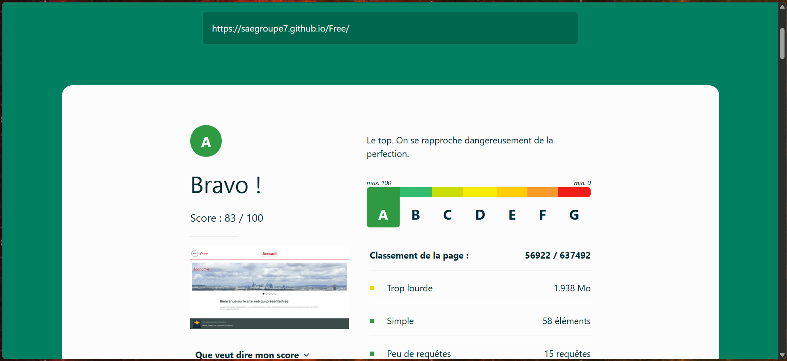

**La page a été faite par Doryann GRAS et les vérifications par Nolan FISCHER.**
### page1.html :  
**Auteur :** Nolan Fischer  
**Utilité :** Économie 

**Lien vers le résultat de conformité de la page 1 :** [Cliquer ici](https://validator.w3.org/nu/?showsource=yes&showoutline=yes&showimagereport=yes&doc=https%3A%2F%2Fsaegroupe7.github.io%2FFree%2Fpage1%2Fpage1.html)

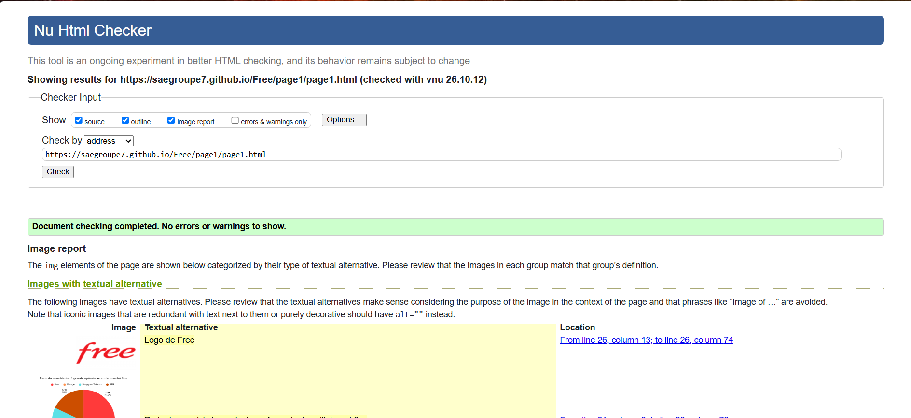

**Lien vers la validation d'éco-conception :** [Cliquer ici](https://www.ecoindex.fr/resultat/?id=ddd5f841-d90f-487a-a786-44065bb39764)

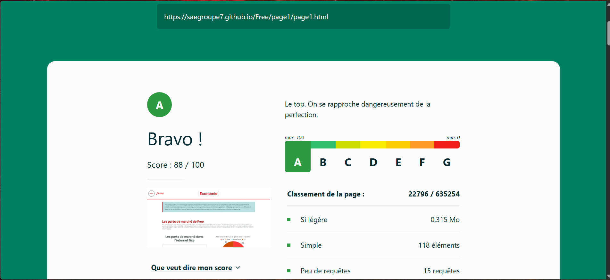

**La page et les vérifications ont été faites par Nolan FISCHER.**

### page2.html :  
**Auteur :** Ilyana Gueraouni  
**Utilité :** Service et produit  

**Lien vers le résultat de conformité de la page 2 :** [Cliquer ici](https://validator.w3.org/nu/?showsource=yes&showoutline=yes&showimagereport=yes&doc=https%3A%2F%2Fsaegroupe7.github.io%2FFree%2Fpage2%2Fpage2.html)

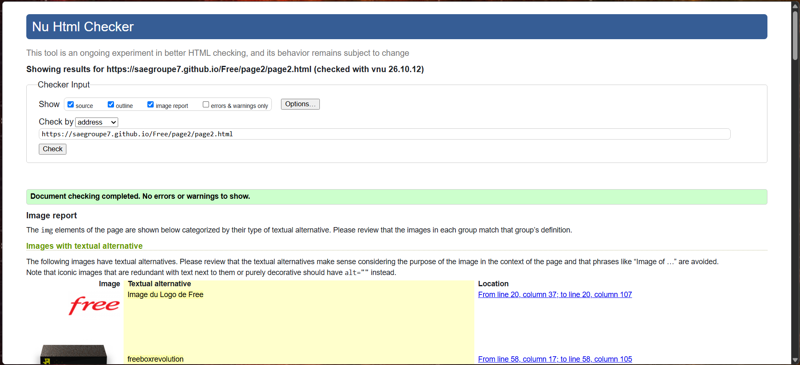

**Lien vers la validation d'éco-conception :** [Cliquer ici](https://www.ecoindex.fr/resultat/?id=a2391d94-6bff-4868-b315-c8be70a24c09)

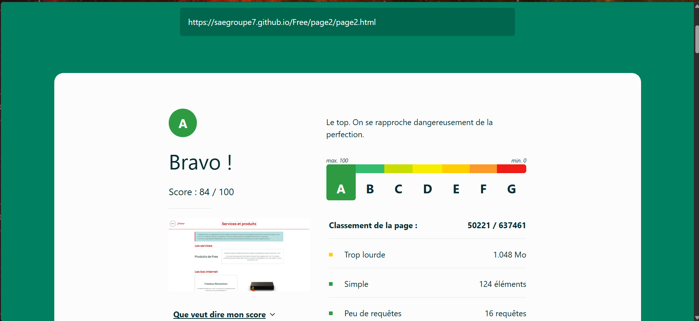

**La page a été faite par Ilyana GUERAOUNI et les vérifications par Nolan FISCHER.**

### page3.html :  
**Auteur :** Mohamed Hedi Hamza  
**Utilité :** Présentation des produits et services  

**Lien vers le résultat de conformité de la page 3 :** [CLiquer ici](https://validator.w3.org/nu/?showsource=yes&showoutline=yes&showimagereport=yes&doc=https%3A%2F%2Fsaegroupe7.github.io%2FFree%2Fpage3%2Fpage3.html)

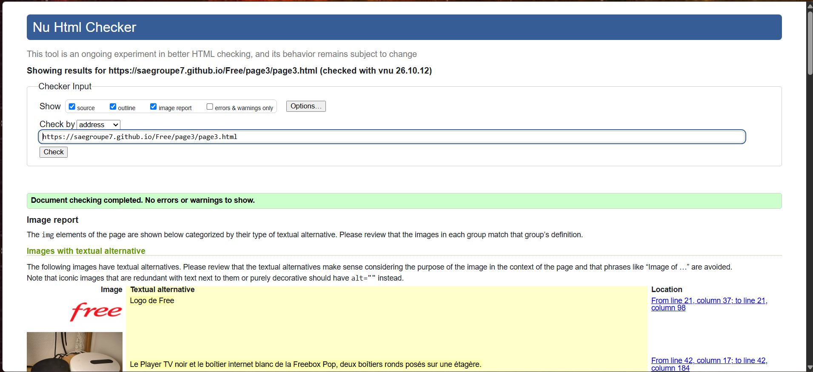

**Lien vers la validation d'éco-conception :** [Cliquer ici](https://www.ecoindex.fr/resultat/?id=a5044207-f727-46d4-b867-62f79509c2e9)

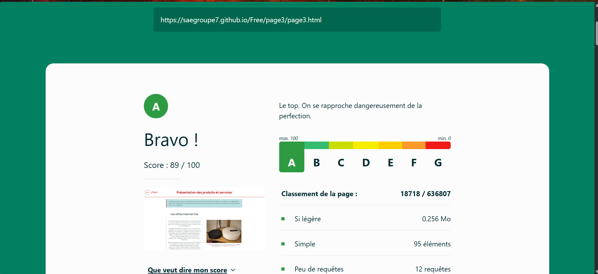

**La page et les vérifications ont été faites par Mohamed Hedi HAMZA.**

### page4.html :  
**Auteur :** Yanis Iklef  
**Utilité :** Histoire de l'entreprise

**Lien vers le résultat de conformité de la page 4 :** [Cliquer ici](https://validator.w3.org/nu/?showsource=yes&showoutline=yes&showimagereport=yes&doc=https%3A%2F%2Fsaegroupe7.github.io%2FFree%2Fpage4%2Fpage4.html)

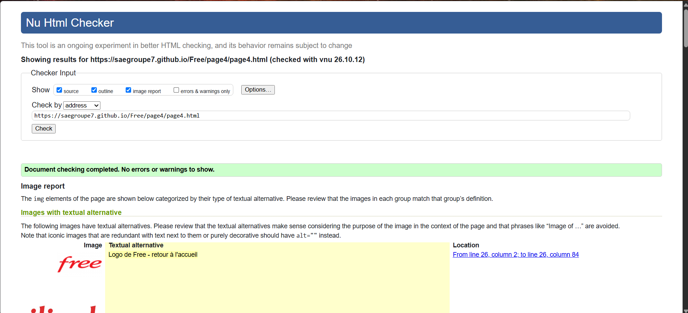

**Lien vers la validation d'éco-conception :** [Cliquer ici](https://www.ecoindex.fr/resultat/?id=a700e5f1-41ad-45d8-9364-32cda1d0907b)

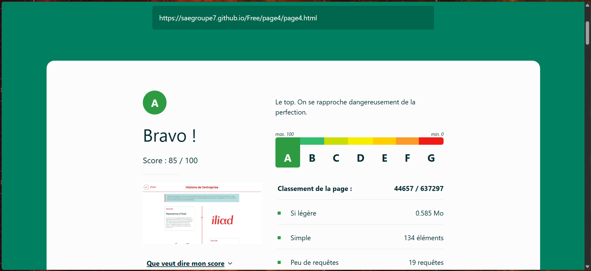

**La page et les vérifications ont été faites par Yanis IKLEF.**

### page5.html :  
**Auteur :** Doryann Gras  
**Utilité :** Initiatives pour l'environnement

**Lien vers le résultat de conformité de la page 5 :** [Cliquer ici](https://validator.w3.org/nu/?showsource=yes&showoutline=yes&showimagereport=yes&doc=https%3A%2F%2Fsaegroupe7.github.io%2FFree%2Fpage5%2Fpage5.html)

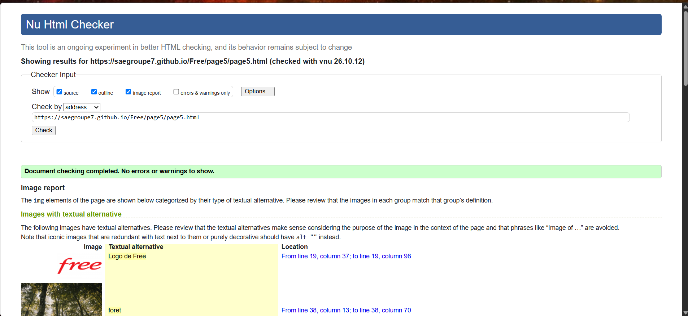

**Lien vers la validation d'éco-conception :** [Cliquer ici](https://www.ecoindex.fr/resultat/?id=102c070f-6d42-4613-b3d8-142808574f2d)

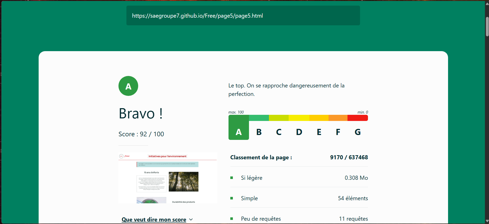

**La page a été faite par Doryann GRAS et les vérifications par Nolan FISCHER.**

## Répartition du travail

### Planification - Diagramme de GANTT

- Hamza Mohamed Hedi
- Iklef Yanis
- Fischer Nolan

### Recherches d'informations

- Hamza Mohamed Hedi
- Iklef Yanis
- Fischer Nolan
- Gras Doryann
- Guearouni Ilyana 

### Développement site

- Gras Doryann
  - Page d’accueil
- Iklef Yanis
  - Page histoire
- Hamza Mohamed Hedi
  - Page organisation
- Fischer Nolan
  - Page eco
- Gueraouni Ilyana
  - Page produits

## Contributeurs
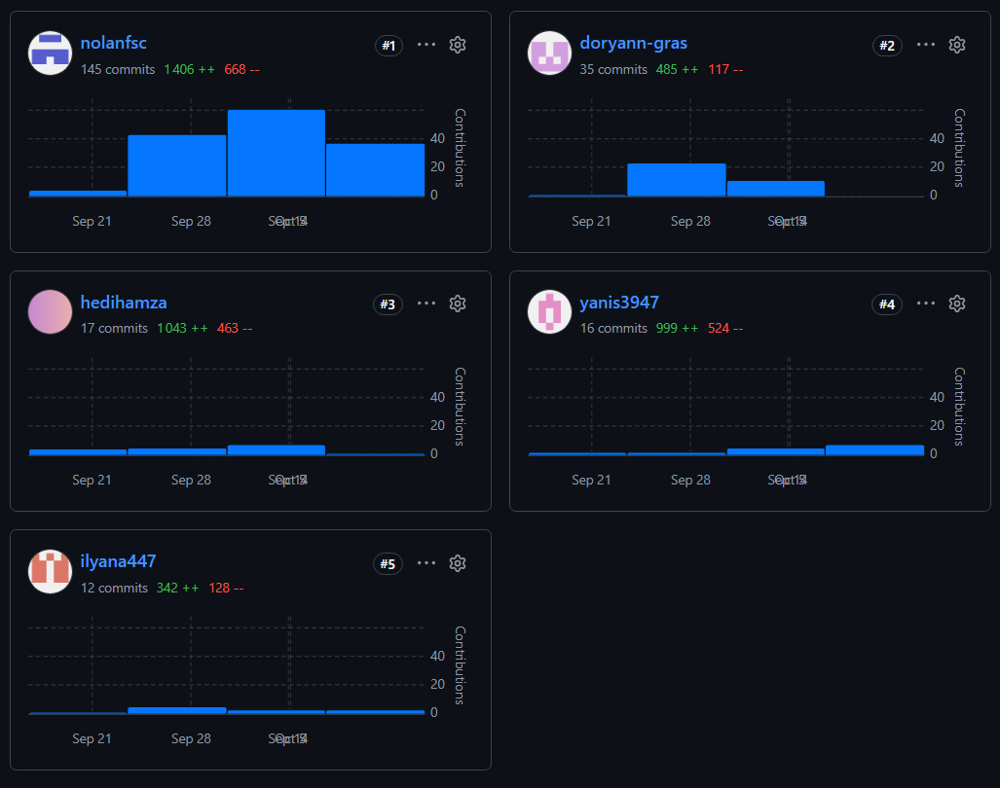
